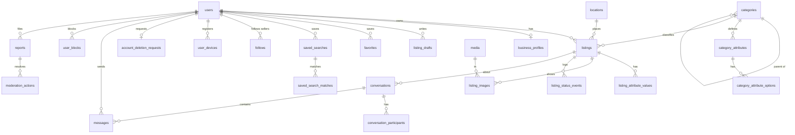

# ERD — نموذج البيانات النهائي (سوقنا MVP)

> مرجع التنفيذ لـMigrations. كل الجداول: `id` من نوع `ulid` أساسي، `created_at`/`updated_at` (timestamptz, UTC)، المبالغ `*_cents` bigint مع `currency` char(3) افتراضيًا `'SYP'` وبديل `'USD'`. كل FK مع `ON DELETE` صريح. `deleted_at` للحذف الناعم حيث مذكور.

## خريطة النطاقات

```
Identity (8) ── users ──┬── personal_access_tokens ── user_devices
                        ├── password_reset_tokens ── user_consents
                        ├── notification_preferences ── account_deletion_requests
                        └── business_profiles (1:1)

Catalog (4) ── categories ── category_attributes ── category_attribute_options ── locations

Listings (6) ── listings ──┬── listing_attribute_values ── listing_images ── media
                           ├── listing_drafts ── listing_status_events

Engagement (5) ── favorites ── saved_searches ── saved_search_matches ── follows ── recently_viewed

Messaging (3) ── conversations ── conversation_participants ── messages

Safety (4) ── user_blocks ── reports ── moderation_actions ── audit_logs

Notifications (1) ── notifications
Platform (4+) ── idempotency_keys ── outbox_events ── data_exports ── feature_flags
                + Laravel: jobs, failed_jobs, job_batches, migrations
```

## 1. Identity & Account

### users
| العمود | النوع | ملاحظات |
|---|---|---|
| id | ulid PK | |
| email | citext | unique where deleted_at is null |
| password | varchar | argon2id hash |
| display_name | varchar(40) | |
| account_type | enum | `private`, `commercial` |
| role | enum | `user`, `moderator`, `admin` — افتراضي `user` |
| status | enum | `active`, `suspended`, `pending_deletion`, `deleted` — افتراضي `active` |
| email_verified_at | timestamptz null | البوابة قبل المراسلة/النشر التجاري |
| default_location_id | ulid FK→locations null | |
| locale | char(2) | افتراضي `ar` |
| last_login_at | timestamptz null | |
| remember_token, deleted_at, timestamps | | |

### personal_access_tokens — قياسي Sanctum
tokenable (morph)، name، token (hash, unique)، abilities json، last_used_at، expires_at (انتهاء بعد 90 يومًا بلا استخدام — سياسة تطبيقية).

### password_reset_tokens — قياسي Laravel
email PK، token (hash)، created_at؛ صلاحية 60 دقيقة، استعمال واحد.

### user_devices
| user_id FK→users cascade | platform enum (`android`,`web`,`ios`) | fcm_token text unique | app_version | last_seen_at | index(user_id) |

### user_consents — append-only
| user_id FK→users cascade | purpose enum (`terms`,`privacy`,`marketing`,`analytics`) | version varchar | granted bool | ip_hash varchar | index(user_id, purpose) |

### notification_preferences
PK مركّب (user_id, type, channel): type ∈ `message`,`search_alert`,`listing_expiry`,`moderation`,`marketing`؛ channel ∈ `push`,`email`,`in_app`؛ enabled bool افتراضي true.

### account_deletion_requests
| user_id FK→users cascade | requested_at | scheduled_for = requested_at + 30 يوم | cancelled_at null | completed_at null | unique جزئي: واحد نشط (completed_at null وcancelled_at null) لكل مستخدم |

### business_profiles — التاجر (1:1)
| user_id ulid unique FK→users cascade | legal_name | store_name | address | governorate | city | public_phone | public_email | register_number null (سجل تجاري اختياري) | compliance_confirmed bool | status enum (`pending`,`verified`,`rejected`,`suspended`) | payload jsonb (المستندات/media ids) | review_note | verified_by FK→users null | verified_at | updated_at |

## 2. Catalog & Location

### categories
| parent_id ulid FK→categories null | slug unique | name_ar | icon | sort_order | is_active bool | allows_shipping bool | allows_wanted bool | index(parent_id, is_active) |

### category_attributes
| category_id FK→categories cascade | key | label_ar | data_type enum (`enum`,`int`,`decimal`,`bool`,`text`) | is_required | is_filterable | sort_order | unique(category_id, key)؛ الخصائص تُورث من الأب في طبقة التطبيق |

### category_attribute_options
| attribute_id FK→category_attributes cascade | value | label_ar | sort_order | unique(attribute_id, value) |

### locations
| governorate varchar | city varchar | district null | lat/lng decimal null | index(governorate, city)، GIN trgm(city)، GiST جغرافي حيث lat/lng موجودة |

## 3. Listings & Media

### listings
| العمود | النوع | ملاحظات |
|---|---|---|
| user_id | ulid FK→users restrict | |
| category_id | ulid FK→categories restrict | |
| offer_type | enum | `offer`, `wanted` |
| title | varchar(70) | |
| description | text ≤4000 | |
| price_cents | bigint null | null عند price_type=free |
| currency | char(3) | `SYP`/`USD` |
| price_type | enum | `fixed`, `negotiable`, `free` |
| status | enum | `active`,`reserved`,`sold`,`expired`,`blocked`,`deleted` (انظر 6.1 بالخطة) |
| location_id | ulid FK→locations | |
| lat/lng | decimal null | مقرّبة ~1 كم عند وجودها |
| shipping_available | bool | |
| carrier | varchar null | |
| published_at / expires_at / reserved_at / sold_at | timestamptz | expires_at = published_at + 60 يوم |
| views_count / favorites_count | int | تُحدَّث تزايديًا |
| version | int | optimistic locking، ++1 كل تعديل |
| search_vector | tsvector | generated من title+description (arabic config + تطبيع) |
| moderation_state | enum | `clean`,`flagged`,`under_review` — افتراضي clean |
| deleted_at | timestamptz null | |

فهارس: `(status, published_at desc)`، `(category_id, status, published_at)`، `(user_id, status)`، `price_cents` حيث status=active، `GIN(search_vector)`، `GIN trgm(title)`، `GiST(earth(ll_to_earth(lat,lng)))` حيث lat/lng ليست null.

### listing_attribute_values
PK مركّب (listing_id, attribute_id): option_id FK null أو value_text/value_number/value_bool؛ index(attribute_id, option_id) للفلترة؛ ON DELETE cascade مع listing.

### media
| owner_id FK→users cascade | disk varchar | original_path | mime enum (`image/jpeg`,`image/png`,`image/webp`) | bytes | width/height | sha256 | status enum (`uploaded`,`processing`,`ready`,`rejected`) | variants jsonb (`thumb`,`card`,`full` → paths) | rejected_reason | index(owner_id, status) |

### listing_images
PK مركّب (listing_id, media_id): position smallint unique(listing_id, position)؛ is_cover bool مع unique جزئي (غلاف واحد: `where is_cover`)؛ ON DELETE cascade.

### listing_drafts
| user_id FK→users cascade | listing_id ulid FK→listings null cascade (null = إعلان جديد) | payload jsonb | media_ids jsonb | version int | unique(user_id, listing_id) حيث listing_id ليس null؛ حد أقصى مسودات لكل مستخدم (سياسة: 50) |

### listing_status_events — append-only
| listing_id FK cascade | from_status | to_status | actor_id FK→users null | actor_type enum (`owner`,`system`,`moderator`) | reason | index(listing_id, created_at) |

## 4. Engagement

| الجدول | المفتاح والقيود |
|---|---|
| favorites | PK(user_id, listing_id)؛ FK cascade |
| saved_searches | user_id FK cascade، name، query، filters jsonb، alerts_enabled، alert_frequency enum (`instant`,`daily`)، last_alerted_at؛ حد 50/مستخدم |
| saved_search_matches | unique(saved_search_id, listing_id)، notified_at |
| follows | PK(follower_id, seller_id)؛ check(follower_id <> seller_id) |
| recently_viewed | PK(user_id, listing_id)، viewed_at؛ upsert؛ احتفاظ بآخر 30 |

## 5. Messaging

### conversations
| listing_id FK→listings restrict | seller_id FK→users restrict | buyer_id FK→users restrict | listing_title_snapshot | last_message_id | last_message_at | unique(listing_id, buyer_id)؛ check(seller_id <> buyer_id) |

### conversation_participants
PK مركّب (conversation_id, user_id): last_read_message_id، archived_at، deleted_at، unread_count int؛ index(user_id, archived_at null, last_message_at desc).

### messages
| conversation_id FK cascade | sender_id FK→users restrict | body varchar(2000) | client_message_id ulid | created_at | moderation_state enum (`clean`,`flagged`,`deleted`) | unique(sender_id, client_message_id) ← Idempotency؛ index(conversation_id, id desc) |

## 6. Safety & Moderation — 4 جداول append-only أساسًا

| الجدول | الأعمدة والقيود |
|---|---|
| user_blocks | PK(blocker_id, blocked_id)؛ يُفحص بالاتجاهين عند إنشاء محادثة وإرسال رسالة |
| reports | reporter_id FK→users null (للضيوف)، reporter_contact null، target_type enum (`listing`,`user`,`message`)، target_id، reason enum، details، evidence_snapshot jsonb، status enum (`open`,`in_review`,`actioned`,`dismissed`)، assigned_to FK→users، resolved_at، resolution_note |
| moderation_actions | moderator_id FK، target_type، target_id، action enum (`block_listing`,`restore_listing`,`suspend_user`,`restore_user`,`warn`,`delete_message`,`verify_business`,`reject_business`)، reason_code، statement_of_reasons، report_id FK null |
| audit_logs | actor_id FK→users null، action، subject_type، subject_id، changes jsonb، ip_hash |

## 7. Notifications
`notifications` قياسي Laravel: id uuid PK، type، notifiable (morph: user)، data jsonb، read_at؛ index(notifiable_id, read_at, created_at).

## 8. Platform & Compliance

| الجدول | الأعمدة |
|---|---|
| idempotency_keys | PK(key, user_id)، endpoint، request_hash، response_status، response_body jsonb، expires_at (24 ساعة) |
| outbox_events | event_type، aggregate_type، aggregate_id، payload jsonb، available_at، processed_at null، attempts int؛ index(processed_at null, available_at) |
| data_exports | user_id FK، status enum (`queued`,`ready`,`expired`,`failed`)، file_path، expires_at |
| feature_flags | key PK، enabled bool، rollout jsonb |

## العلاقات الأساسية (Mermaid)



## قواعد لا تظهر في المخطط
- `unread_count` و`favorites_count` و`views_count` عدادات مناقضة (denormalized) تُحدَّث في نفس Transaction أو عبر Redis drain.
- `listing_drafts.listing_id` null ↔ مسودة إعلان جديد؛ غير null ↔ مسودة تعديل لإعلان منشور.
- حذف المحادثة «من جهتي» = `conversation_participants.deleted_at`، والرسائل تُحتفظ 12 شهرًا للبلاغات.
- `business_profiles.status` يعيد `pending` تلقائيًا عند تعديل: legal_name، store_name، address، register_number، public_phone، public_email.
